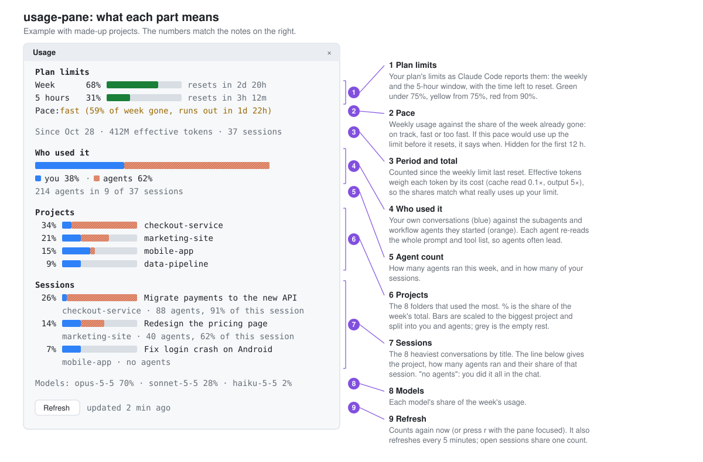

# claude-usage-pane

A pane beside the Claude Code chat that answers "where did my tokens go this week?" It shows your plan limits live, whether you are using the weekly limit faster than the week is passing, and which projects, sessions and agents used the most.



## What it shows

- **Plan limits**: the weekly and 5-hour windows as Claude Code reports them, with time to reset. Green below 75%, yellow from 75%, red from 90%.
- **Pace**: the share of the weekly limit used against the share of the week gone. If the current pace would use up the limit before it resets, the row says when. It stays hidden for the first 12 hours of a week.
- **Who used it**: your own conversations against the subagents and workflow agents they started. Agents usually dominate: each one starts by reading the full system prompt and tool list.
- **Projects and sessions**: the eight biggest of each this week, split the same way.

## Install

Requires Claude Code with function-hook plugins (mods), 2.1.309 or newer, and Python 3 on your PATH.

At the prompt of a terminal session:

```
/plugin install usage-pane --marketplace Swiderek/claude-usage-pane
```

From a shell:

```
claude plugin install usage-pane --marketplace Swiderek/claude-usage-pane
```

In the desktop app, where `/plugin` does not run: click + next to the prompt box, then Plugins, Add marketplace with `Swiderek/claude-usage-pane`, then Add plugin.

The pane opens when an interactive session starts. `/usage-pane` opens it again after you close it.

## Settings

| Option | Values | Default |
| --- | --- | --- |
| `panel` | `auto` opens the pane at session start; `command` opens it only with `/usage-pane` | `auto` |

Change it in `/config`, under the plugin's rows.

## How the numbers are counted

The plugin reads the transcripts Claude Code keeps on your machine (`~/.claude/projects/**/*.jsonl`) with `scripts/usage.py`. It counts every model response since the weekly limit last reset, once, and weights each kind of token by its cost against a plain input token:

| Token kind | Weight |
| --- | --- |
| input | 1× |
| cache read | 0.1× |
| cache write, 5 minutes | 1.25× |
| cache write, 1 hour | 2× |
| output | 5× |

The result is "effective tokens": a share of your usage, not a bill. Percentages in the pane are shares of that total. The plan-limit percentages come from Claude Code itself.

The count refreshes every 5 minutes. Sessions open at the same time share one count for 4 minutes, so several open sessions do not each re-read your transcripts. **Refresh** (or `r` while the pane has focus) counts again right away.

## Privacy

- Everything stays on your machine. The plugin makes no network requests.
- It reads only `~/.claude/projects`, and shows project folder names and session titles in the pane.
- It runs one local command, `python3 -I scripts/usage.py`, without a shell.

## Limitations

- The transcript format is internal to Claude Code and not a stable interface. An update can change it and break the count.
- Conversations on claude.ai (web, desktop or mobile chat) are not stored locally, so they are not counted here, although they count toward the same plan limits.
- `-p` runs and SDK hosts do not open the pane or count in the background.

## Development

```
claude plugin validate .
claude plugin test .
```

## License

MIT, see [LICENSE](LICENSE).
